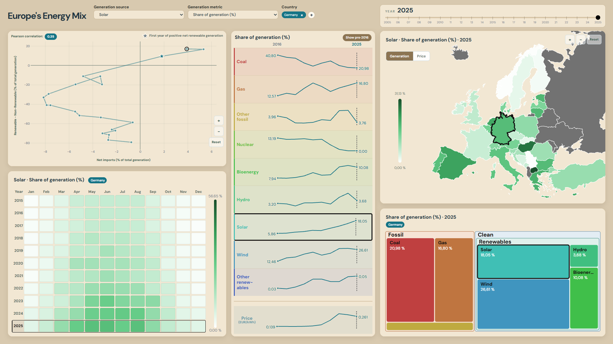

# Europe's Energy Mix

An interactive dashboard for exploring electricity generation and household electricity prices across European countries. Compare energy sources over time and explore generation, renewable balance, and emissions intensity through linked charts and maps.

## Preview



## Features

- Filter by country, year, generation source, and metric.
- Compare generation by source, including generation share, generation in TWh, and emissions intensity.
- Explore country-level patterns with interactive maps and charts, including a calendar heatmap, connected scatterplot, treemap, and sparklines.
- View household electricity price trends.

## Run locally

From the repository root, start a local server:

```bash
python -m http.server 8000
```

Then open <http://localhost:8000> in your browser. The dashboard loads its data from the CSV files in `data-processing/export`.

## Data

The dashboard uses prepared CSV exports in `data-processing/export`. The processing script and its input data are in `data-processing/src`.

### Sources

- **Yearly electricity generation data:** [Ember Yearly Electricity Data](https://ember-energy.org/data/yearly-electricity-data/)
- **Monthly electricity generation data:** [Ember Monthly Electricity Data](https://ember-energy.org/data/monthly-electricity-data/)
- **Household electricity prices in the EU:** [Eurostat dataset nrg_pc_204](https://ec.europa.eu/eurostat/databrowser/view/nrg_pc_204__custom_22839813/default/table)
- **Household electricity prices in the UK:** [UK Quarterly Energy Prices](https://www.gov.uk/government/collections/quarterly-energy-prices)

## Project structure

```text
.
├── assets/                       # Dashboard assets
├── data-processing/
│   ├── export/                   # CSV files used by the dashboard
│   └── src/                      # Data preparation script and source data
├── idioms/                       # Individual chart implementations
├── vendor/                       # Vendored D3 and TopoJSON libraries
├── dashboard.css                 # Dashboard styles
├── dashboard.js                  # Dashboard behavior and data loading
└── index.html                    # Dashboard page
```

## Built with

- HTML, CSS, and JavaScript
- [D3.js](https://d3js.org/)
- [TopoJSON](https://github.com/topojson/topojson)
- Python and pandas for data preparation
